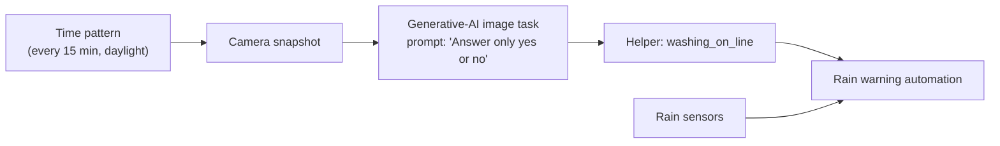

# AI Vision Automations: Camera Snapshots, Generative-AI Checks and Local Detection (WIP)

**Using vision as a sensor in Home Assistant. A cloud generative-AI model inspects outdoor camera snapshots and answers narrow questions ("is washing on the line?"), and the answer drives automations such as rain warnings. The repo also covers where vision was *rejected* in favour of a proper sensor (boiler pressure), and the plan for local, private detection with RTSP cameras and Frigate, including a bird-feeder species camera.**

> **The short version:**
> - **Live:** a daylight check every 15 minutes sends an outdoor camera snapshot to a generative-AI image task with a **yes/no prompt**, sets a helper, and the helper combines with rain data to warn when the washing is out and it starts raining. One automation now checks both the washing line and the driveway.
> - **Rejected for the boiler gauge:** a pressure transducer was chosen over camera reading.
> - **Planned:** local RTSP cameras with **Frigate** (cloud doorbell cameras can't feed it) and a **bird-feeder** species camera.

**Portfolio position:** Automation level · vision as a sensor. Related: [HA integration schedule](https://github.com/the-control-cabinet/home-assistant-integration-schedule) · [Heating plant monitoring](https://github.com/the-control-cabinet/heating-plant-monitoring-esphome)

---

## 1. Pattern: vision as a binary sensor

**Design points:**
- **Ask a narrow question with a constrained answer** ("Answer only 'yes' or 'no'"), so the output is machine-parseable.
- **Store the result in a helper**, so other automations reuse it without re-querying.
- **Restrict to daylight** (sun condition): night images are unreliable, and fewer queries cost less.
- **Treat it as a slow sensor:** a 15-minute cadence suits laundry, but not security.

Config: [washing-line check](config/washing-line-check.yaml) · [rain warning](config/rain-while-washing-out.yaml)

## 2. Use cases

| Use case | Method | Status |
|---|---|---|
| Washing on the line | Cloud AI image task (yes/no) → helper | ✅ Live |
| Driveway / outdoor check | Same pattern, combined automation | ✅ Live |
| Boiler pressure gauge | AI reading of an analogue gauge was considered | ❌ Superseded by a **pressure transducer**: a direct electronic measurement beats inferring from images |
| Bird-feeder species alerts | Window feeder camera → local detection → AI species ID | 📐 Planned |
| Local object detection | RTSP/ONVIF cameras + Frigate on the head-end | 📐 Planned |

## 3. Lessons
- **Vision is a last resort for measurement.** For the boiler gauge, a transducer gives continuous, calibrated data with no inference errors. Use vision where no sensor exists (washing on a line).
- **Cloud doorbell cameras don't provide RTSP streams**, so local NVR or detection (Frigate) needs RTSP/ONVIF cameras.
- **Cost control:** keep queries constrained (daylight only, a 15-minute interval), and watch the AI provider's billing and free-tier settings. A billing change once broke the integration until it was corrected.
- **Local alternatives exist** for specific tasks (e.g. open-source analogue-gauge readers on ESP32 cameras), with no per-request cost and no cloud dependency.
- **ESP32-S3 camera boards** managed about **6 fps** at modest resolution over Wi-Fi, which is fine for snapshots but not smooth video.

## 4. Roadmap
- [ ] RTSP/ONVIF outdoor camera(s) + Frigate on the head-end (local detection, no cloud).
- [ ] Bird-feeder camera: local motion/bird detection, then AI species identification, then a notification with an image.
- [ ] Confidence handling: re-query on ambiguous answers; ignore results when the image is dark or obstructed.
- [ ] Evaluate a local vision model for the yes/no checks (privacy, no per-request cost).

## 5. Skills demonstrated

| Skill | Evidence |
|---|---|
| Vision as a sensor | Constrained prompts → binary helper → automations |
| Sensor selection judgement | Vision rejected where a direct transducer is better |
| Privacy and cost awareness | Daylight-only, interval-limited queries; a local detection roadmap |
| Integration | Camera, AI task, helpers and rain data combined |

📺 [The Control Cabinet on YouTube](https://www.youtube.com/channel/UC5Cupmz7vlfcodpCX7k8iuQ)

*Built and documented by James · part of [The Control Cabinet BMS portfolio](https://github.com/the-control-cabinet). MIT Licence.*
